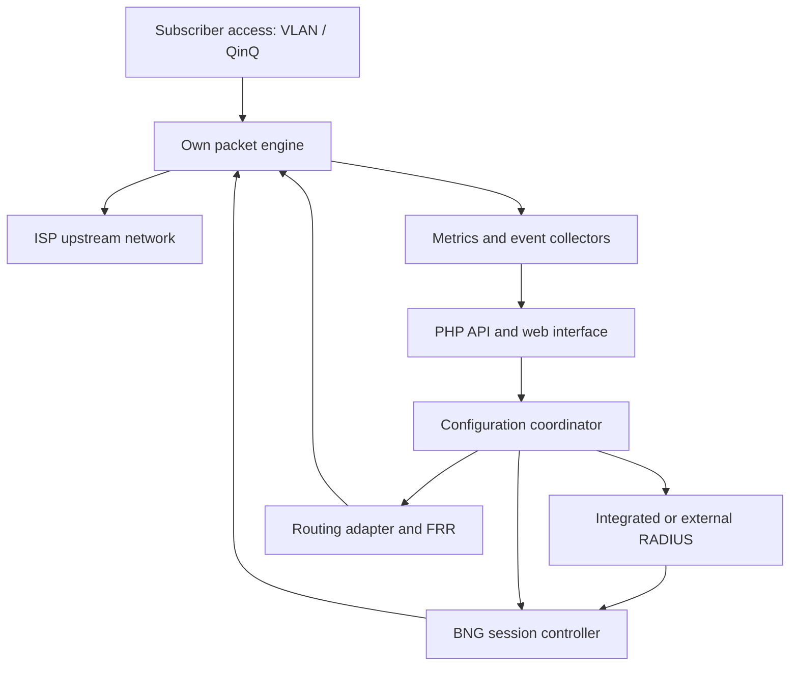

# ISP Network Platform — Full Development Plan

Version 1.0 · Prepared 4 November 2026 · Working name: LiquidNat


name the components like: LiquidNAT Gateway, LiquidNAT RADIUS, and LiquidNAT Manager,

## 1. Purpose and decisions

Build a commercial, installable ISP network software platform combining an independently developed packet engine, broadband network gateway (BNG), carrier-grade NAT (CGNAT), integrated RADIUS, subscriber and policy management, routing integration, diagnostics, and resilient operation. The customer is an ISP operating its own infrastructure. The business sells software and optional support; it does not become a wholesale broadband carrier.

The product must be easy to evaluate, install, administer, update, and recover. Reduced support workload is a design requirement. It is not a promise that production network software can be operated without a qualified engineering and incident-response team.

This is an implementation specification and proposed delivery plan, not evidence that the software exists or that its performance has been measured. All capacities, schedules, staffing, costs, and commercial terms below are planning assumptions to validate. Sources at the end establish technical foundations and competitor scope; the architecture and acceptance targets are recommendations for this product.

### Decisions proposed for the first architecture review

| Decision | Recommended baseline | Reason |
|---|---|---|
| Packet engine | Own C++ engine using DPDK drivers and libraries | Own forwarding, NAT, scheduling, session tables, and policies without writing NIC drivers |
| BNG control | Own Go service managing PPPoE/IPoE and programming the engine | Own subscriber lifecycle and diagnostics |
| RADIUS | Bundle and manage a supported FreeRADIUS release behind your own policy service | Integrated server in the product without inventing authentication protocol machinery |
| Routing protocols | Bundle FRRouting and build an adapter to your engine | Own forwarding while using an established BGP/OSPF implementation |
| Management | PHP backend, TypeScript frontend, PostgreSQL | Familiar web development with a clean boundary from real-time networking |
| Packaging | Versioned Linux appliance image, initially one x86-64 platform family | Predictable operating environment and lower support cost |
| First performance objective | Laboratory 10 GbE reference profile | Small enough to establish correctness; must include packet-rate and session-rate tests |
| Initial access protocols | PPPoE and IPoE; sequence based on pilot requirements | Both needed for broad ISP suitability |
| Resilience | Active/standby appliance pair, explicit state guarantees | Simpler initial ownership model than active/active |
| Demonstrations | Hosted simulated browser demo plus real downloadable virtual lab | Fast evaluation and technical proof |
| Public availability | Release gates based on measurements, not a calendar deadline | Avoid selling unproven reliability |

Using FreeRADIUS and FRRouting does not change the requirement for your own packet engine. These are separate services. If independently implementing the RADIUS protocol server is also a firm business requirement, use the optional workstream in section 12 and fund it separately. Do not silently substitute VPP, nftables, or an existing BNG for the promised production engine.

## 2. Product boundaries and buyers

Primary initial buyer: a small or medium ISP with an engineer capable of configuring VLANs, routes, RADIUS, and server networking. Start with operators whose required topology fits a published reference design. Large operators with unusual access networks and strict service commitments belong in later design partnerships.

Supported eventual roles:

1. Standalone CGNAT behind an existing BNG.
2. BNG with integrated RADIUS, using either public subscriber addresses or CGNAT.
3. Distributed gateways managed by a central controller.
4. RADIUS and subscriber management integrated with an ISP's existing billing system.
5. Separate tenant/ISP administration where routing and resource isolation have been certified.

The first version does not need to include a general billing ledger, payment gateway, DNS hosting platform, ACS, full DDoS scrubbing service, or every routing protocol. Integrate with billing and ACS products through APIs. Advanced IPv4 transition mechanisms, MPLS/EVPN, lawful-interception interfaces, L2TP LAC/LNS, and active/active clustering each require their own specification before being offered.

CityFibre remains a potential deployment environment, not a dependency of this software business. Obtain the applicable handoff, VLAN, MTU, subscriber identity, and authentication specification from each pilot operator. Do not infer it from the access-network brand or hard-code a single network's behaviour.

### Validate demand before major implementation

- Interview 10–15 potential ISP buyers using the same structured questionnaire.
- Capture current BNG, CGNAT, RADIUS, hardware, billing integration, number of subscribers, busiest-hour traffic, connection creation rate if known, and operational pain points.
- Ask what would make them switch, what would prevent switching, and whether they need 24/7 support.
- Secure 2–3 design partners willing to supply anonymised configuration examples, lab access, and a named technical contact.
- Ask for willingness to fund a pilot or sign a conditional purchase commitment. Interest alone is weak evidence.
- Produce a requirements matrix identifying the common core and customer-specific requests.
- Stop or narrow scope if the buyers only want a cheaper licence while demanding enterprise support and full feature parity immediately.

## 3. Competitive baseline and honest parity claims

netElastic publicly describes BNG, CGNAT, virtual routing, and netVision management. Its BNG material includes PPPoE, IPoE and L2TP LAC/LNS. These are comparison inputs, not proof of the precise functionality or limits of a customer's licensed deployment. [S1–S2]

Maintain a dated competitor matrix with the following fields: capability, vendor/version, official evidence, our status, supported configuration, tested limit, and missing behaviour. Refresh it before each major release. Never use “complete replacement” without defining which product, version, deployment, and features are covered.

| Capability | Prototype | Limited pilot | Initial general availability | Expansion |
|---|---|---|---|---|
| IPv4/IPv6 forwarding | Yes | Yes | Yes | Larger tables and throughput |
| CGNAT TCP/UDP/ICMP | Functional subset | Full declared profile | Tested profile and traceability | More allocation modes and scale |
| PPPoE termination | Lab | Selected CPE | Certified matrix | More access profiles |
| IPoE/DHCP | Lab | Selected handoff | Certified matrix | More relay/topology modes |
| Integrated RADIUS | Lab | Auth/accounting/CoA | Resilient deployment | Broader attribute compatibility |
| External RADIUS | Lab | One integration | Supported server matrix | More proxies and vendor dictionaries |
| IPv6 prefix delegation | Lab | Required before dual-stack pilot | Certified profile | More policies |
| Per-subscriber shaping | Basic | Up/down and aggregate limits | Measured under congestion | More hierarchy/scale |
| BGP/OSPF | Adapter prototype | Selected routing profile | Tested routing matrix | Additional protocols |
| Configuration and diagnostics | Basic | Required | Required | Fleet workflows |
| NAT/BNG state failover | Research | Clearly labelled guarantees | Required for HA claims | Active/active research |
| L2TP LAC/LNS | Deferred | Only if separately funded | Optional later release | Needed for broader parity |
| MPLS/EVPN/VRF edge functions | Deferred | Deferred | Only declared subset | Dedicated workstreams |
| Multi-tenant isolation | Designed | Internal testing | Single ISP by default | Commercial tenant isolation after tests |

A pilot is allowed to have limited functionality when disclosed. General availability requires a supported configuration matrix, reliable operations, documented recovery, and no hidden dependence on manual developer intervention.

## 4. Architecture and failure boundaries

Separate three responsibilities: the data plane moves traffic; the control plane establishes sessions and policies; the management plane is used by administrators and integrations. Loss of the web interface, cloud portal, or licence service must not directly interrupt established forwarding.



The diagram shows responsibility and control relationships, not every packet direction or a prescribed physical topology. Each deployment needs an explicit management network, subscriber-facing interfaces, upstream interfaces, and, for HA, a replication network.

### Services and their responsibilities

| Service | Proposed technology | Responsibilities and persistence |
|---|---|---|
| `packetd` | C++20 with selected DPDK release | Forwarding, ACLs, NAT, per-subscriber enforcement, counters; in-memory hot state |
| `bngd` | Go | PPPoE/IPoE lifecycle, DHCP/PPP coordination, admission, address ownership, accounting events |
| `policyd` | Go | Compiled subscriber/service policies and local caches; deterministic versioned evaluation |
| `radiusd` | Bundled FreeRADIUS | RADIUS protocol handling, integrated policy adapter, proxy/external integration |
| `routingd` | FRR plus own Go/C++ adapter | BGP/OSPF control and forwarding-table reconciliation |
| `configd` | Go | Validate, stage, apply, confirm, audit, and roll back configuration revisions |
| `had` | Go with a reviewed coordination mechanism | Node roles, health, fencing, state compatibility, failover orchestration |
| `eventd` | Go | Bounded durable spool and event export; no web/database writes on packet workers |
| `applianced` | Go | Restricted host operations: service lifecycle, update staging, backup, diagnostics |
| Management API | Supported PHP framework | Accounts, API, policies, operations, tenancy, audit, and billing integrations |
| Frontend | TypeScript with a maintained UI framework | Setup, inventory, diagnostics, graphs, and change previews |
| Config database | PostgreSQL | Desired configuration, identities, policy revisions, job metadata, and audit indexes |
| Telemetry storage | Initially Prometheus-compatible metrics plus event storage | Low-cardinality time series and retained operational events |
| Optional analytics | ClickHouse or equivalent after measurement | High-volume NAT/session search; not a prerequisite for packet forwarding |

Use a deliberately small number of deployable packages. Separate service responsibilities do not require Kubernetes or a large microservice platform. Prefer systemd-managed daemons on the appliance and a simple deployment for the controller.

### Dependency behaviour

| Failure | Required behaviour |
|---|---|
| Web UI/PHP API unavailable | Existing traffic and network protocols continue; CLI remains available |
| Vendor cloud/portal unavailable | Local management and forwarding continue; queue optional reporting |
| Configuration DB unavailable | Continue last committed configuration; prevent unsafe writes; cache rules apply to new sessions |
| RADIUS unavailable | Keep established sessions under existing policy; reject or queue new authentication according to explicit policy; never default to unrestricted access |
| Policy service unavailable | Use valid compiled policy already installed; no unknown-policy admission |
| Metrics backend unavailable | Bounded buffers and visible telemetry gaps; forwarding continues |
| Mapping log exporter unavailable | Durable spool; apply defined admission restrictions before losing mandatory traceability |
| Packet engine fails | HA takeover if certified; otherwise clear outage and controlled recovery |
| Licence endpoint unreachable | Continue locally licensed operation using signed entitlements and grace policy |

## 5. Deployment profiles

### Development and demonstration

One management VM, one gateway VM, and one traffic/subscriber test VM. Use isolated virtual networks. A combined VM image is acceptable for tutorials, but label its lack of node resilience. The browser simulation has its own deployment and no access to these customer environments.

### Initial production reference design

- Two identical gateway servers, each capable of carrying the whole protected load with reserve capacity.
- Separate physical or strongly isolated management access.
- Dual subscriber/upstream paths supported by the customer's network.
- Dedicated or isolated replication path with measured latency, loss, and bandwidth.
- RADIUS replicas in different failure domains. Do not assume two containers on one host are redundant.
- Controller and database placement documented independently of the forwarding pair.
- Out-of-band console access for failed network configuration and OS recovery.
- If automatic failover uses a quorum, provide a third voter/witness and real fencing. A two-node cluster with no arbitration cannot safely resolve every partition.

### Distributed deployment

Multiple gateway pairs per region, each able to continue operating during controller loss. Keep subscriber state local to its owning pair initially. Synchronise intended configuration centrally; do not create a global per-packet dependency. Region-wide disaster recovery and subscriber migration are separate from local HA.

## 6. Hardware, operating system, and lab requirements

Choose one supported long-lived Linux base at project start. Pin its kernel, DPDK, compiler, firmware, and driver versions in a bill of materials. Upgrade them through tested releases, not automatic distribution package upgrades on live appliances.

Initial lab equipment should include two identical devices under test, a separate adequately sized traffic generator, a managed VLAN-capable switch, test CPE, and independent console access. A traffic generator sharing the DUT's CPU or NIC bottleneck cannot validate appliance performance.

Candidate reference server specification for investigation, not a certified sizing recommendation:

- x86-64 CPU with enough physical cores for packet workers, control services, and reserve capacity; start investigating 16–32 cores.
- 64–128 GB ECC RAM for experiments; actual requirement determined from session tables, packet buffers, routing tables, and failover headroom.
- Supported dual-port or multi-port 10/25 GbE NIC, adequate PCIe lanes, and verified firmware.
- Mirrored enterprise SSDs for the OS/configuration; separate capacity/endurance planning for mapping logs.
- Dual power supplies and remote management where the product is sold as resilient.
- Explicit NUMA placement, hugepage allocation, IOMMU configuration, and CPU affinity.

Maintain separate certifications for bare metal, VM with virtual NICs, and VM with passthrough/SR-IOV. VM functionality does not establish equivalent performance. Initially certify one hypervisor family and one NIC family; expand when customer demand justifies the testing cost.

Never claim “runs on any server”. Publish exact CPU/NIC/firmware/kernel configurations and allowed deviations. Installation should refuse unsupported critical configurations or label them as lab-only.

## 7. Own packet engine: implementation specification

DPDK supplies packet I/O and supporting libraries; it does not supply the finished product's NAT behaviour, BNG, controller, or operational guarantees. Choose a supported stable release after testing, rather than tracking development releases. [S3]

### 7.1 Receive-to-transmit pipeline

Implement independently testable stages:

1. Receive a bounded burst from the NIC queue.
2. Validate buffer lengths and decode Ethernet, VLAN/QinQ, and relevant encapsulation.
3. Classify tenant/VRF and subscriber attachment before looking up subscriber state.
4. Handle access-control protocols through a bounded, rate-limited control queue.
5. Validate IPv4/IPv6 headers, TTL/hop limit, fragmentation, and extension-header policy.
6. Enforce anti-spoofing, subscriber status, and ingress policy.
7. Perform connection and NAT lookup where appropriate.
8. Apply translation, checksum updates, and reverse-path state creation rules.
9. Route in the correct forwarding table; resolve next-hop adjacency.
10. Enforce subscriber/aggregate egress shaping and scheduling.
11. Rewrite L2/encapsulation fields and transmit.
12. Aggregate counters and emit bounded asynchronous events.

Specify the actual stage order per direction and protocol. Inbound reverse NAT may need to occur before the subscriber route lookup. Hairpin forwarding requires a distinct tested path. Do not implement every direction by blindly sharing one pipeline order.

### 7.2 State ownership and concurrency

- Give each connection one authoritative worker and explicit ownership for forward and reverse tuples.
- Include VRF/tenant in keys so identical private IPs cannot collide across customers.
- Define routing of packets arriving on a different worker. NAT changes hashes, so NIC RSS alone does not guarantee symmetric ownership.
- Evaluate steering by allocated public port ranges, software dispatch, and hardware flow steering. Benchmark worst-case cross-worker traffic.
- Use bounded tables and preallocated pools in hot paths. Avoid unbounded allocation, synchronous logs, or database calls.
- Maintain generation IDs to protect against stale handles and reused table entries.
- Use timer wheels or equivalent bounded timer structures for expiry; prove expiry behaviour under overload.
- Reserve resources for control traffic so data overload cannot prevent management and orderly failover.
- Specify memory reclamation for immutable policy/FIB snapshots; prevent use-after-free across cores.
- Begin with one NUMA node; add multi-socket scale only after measuring remote-memory cost.

### 7.3 Forwarding details

Implement ARP, neighbour discovery, neighbour expiry, rate-limited resolution, VLAN/QinQ editing, MTU checks, ICMP error generation, and correct checksum/offload interaction. Define fragment handling and IPv6 extension-header limits. Test PPPoE overhead and path MTU in both directions. Unsupported packets must produce a bounded, observable outcome instead of crashing or bypassing policy.

Routes and adjacency updates require atomic usable versions. Mark unresolved next hops clearly. Decide whether to drop or bounded-buffer while resolving; never allow an unbounded neighbour queue. Support ECMP only with defined NAT symmetry and failover semantics.

### 7.4 Engine control API

Use a versioned binary API over a protected local socket initially, with mTLS for remote node control. Commands must be authenticated, authorised, bounded, and idempotent. Include request ID, node epoch, policy generation, desired revision, and deadline.

Operations: stage policy/FIB snapshots; activate revision; create/update/remove subscriber; query counters; drain worker/node; inspect a sampled flow; export snapshot; apply state replica; health; and capabilities. Bulk operations need explicit size limits and partial-failure reporting.

Management sends validated intent, not shell commands. Engine replies with accepted/applied/rejected status and structured reason codes. A web request timing out must not leave operators guessing whether a change applied.

### 7.5 Prototype completion

First demonstrate two-way IPv4 forwarding between isolated interfaces, then IPv6, VLANs, static routes, and NAT. Build the measurement harness first. A working ping is the first test, not the completion criterion. Release no performance claim until independent traffic generation confirms rate, size distribution, loss, latency, session churn, and CPU/memory behaviour.

## 8. CGNAT specification

Maintain a requirement-by-requirement standards matrix using RFC 6888 and its referenced/updated NAT behaviour documents. This plan is not a declaration of standards conformance. Deterministic allocation and explicit subscriber port requests deserve separate design review. [S4–S6]

### Features

- NAT44 for TCP, UDP, and ICMP with a documented mapping and filtering behaviour.
- Sticky subscriber/public-IP allocation where configured, dynamic pools, deterministic blocks, and explicit per-subscriber limits.
- Correct ICMP identifiers and translated embedded headers for error messages.
- Hairpin behaviour, fragments, out-of-order packets, retransmissions, and idle expiry.
- Static public IPv4 bypass and approved static mappings as explicit services.
- Controlled handling of PCP or another approved explicit mapping protocol; verify the applicable standards requirement before claiming CGN compliance.
- Predictable exhaustion: refuse new allocations with a clear reason while maintaining valid existing state.
- Per-subscriber connection and new-flow limits, with abuse protection that avoids starving other subscribers.
- Documented ALG policy. Avoid silently adding SIP/FTP helpers; each supported ALG adds security, compatibility, and test requirements.

### Allocation model

Pool identity includes tenant/VRF, public range, allowed port range, reserved ports, block size, ownership group, and revision. Keep private address assignment history and subscriber identity correlated with mapping history. Define public-address movement across nodes and pool changes during active connections.

A simplified planning example: ports 1024–65535 give 64,512 candidate port numbers. With fixed blocks of 512, this is 126 blocks per public IP per transport protocol before reservations and policy constraints. It is not a guarantee of 126 subscribers or a fixed number of application sessions: real demand, mapping semantics, extra blocks, simultaneous use, and failure capacity change the result. Size pools from measured subscriber demand.

Port ownership and lease expiry must remain unique across HA nodes. Reusing an external tuple too soon can misdeliver delayed packets; document and test reuse delay against the implemented protocol behaviour.

### Traceability and event integrity

Every accepted allocation must be attributable through an unbroken chain: public IP/port/protocol and timestamp → allocation revision/interval → private address/session → subscriber/tenant. Queries must return uncertainty when timestamps or records are incomplete; never manufacture a confident subscriber match.

Record public/internal addresses, port or block, protocol, subscriber/session ID, tenant/VRF, node/epoch, UTC start/end, reason, event sequence, configuration version, and clock-health information. Record deterministic rules and historical revisions; “deterministic” does not mean “no records needed”. [S5]

Use durable allocation events rather than blocking a worker for every packet. Before allowing traffic on a newly allocated block, ensure its attribution is durably recoverable under the advertised failure model. Prototype batching, write-ahead reservation, and replication trade-offs. If a required journal is full, stop admitting affected new allocations and alert; do not silently discard mapping records. Retention is customer-configurable and requires the operator's own policy, rather than a hard-coded claim about legal compliance.

## 9. Broadband gateway: subscriber lifecycle

Create an explicit state machine: discovered → identifying → authenticating → authorised → allocating → programming → active → changing/draining → disconnecting → released. Include failed and retry states with bounded backoff. Every transition has a reason, timestamp, operation ID, and cleanup action.

Do not expose a session as active until address reservation, policy installation, and required accounting admission are consistent. Prevent duplicate or abandoned address leases when authentication succeeds but programming fails. Distinguish a user account, an access circuit, and a session; one account may legitimately have more than one service.

### PPPoE

Implement discovery and session lifecycle, service/access-concentrator selection, duplicate discovery handling, retransmissions, negotiated MTU/MRU, PPP LCP, approved PAP/CHAP methods, IPCP, IPv6CP, termination, and idle/liveness handling. IPv6CP does not itself delegate subscriber prefixes; implement and test the separate IPv6 address/prefix provisioning path.

Account for per-access VLAN and QinQ identity, session IDs, MAC addresses, circuit/remote identifiers where available, session-count limits, reconnect storms, and stale sessions after reboot. Model the virtual access-concentrator identity in HA; a NAT table copy alone cannot preserve a PPP session.

### IPoE

Implement the selected DHCPv4 server/relay profile, DHCPv6/PD, trusted relay handling, address reservations, renew/rebind/release, lease expiry, and routing installation. Define source binding using trusted attachment context, not an arbitrary subscriber-supplied MAC or Option 82 value. Treat subscriber-provided relay identifiers as untrusted unless overwritten or validated by the access network.

Support an explicitly configured static-address profile if required. Identify circuit changes and distinguish genuine moves from spoofing. Specify traffic-triggered session admission only when the identity and authorisation model is clear.

### Recovery and policies

Reconcile sessions after control-service restart without automatically tearing down valid traffic. During an unresolved authority problem, preserve installed policy and prevent unsafe new allocations. Define all cleanup when CPE disappears, the circuit moves, accounting fails, RADIUS rejects, or a tenant is disabled.

## 10. IPv6 and addressing

Dual-stack is part of the product architecture from the start. Build IPv6 forwarding, neighbour discovery, MTU/ICMPv6 correctness, subscriber addressing, prefix delegation, route lifecycle, and ACLs into the first end-to-end journey.

Provide pools for CGN private IPv4, public IPv4, IPv6 WAN addresses where used, and delegated prefixes. Allocation keys include tenant/VRF. Enforce non-overlap inside a routing domain, explicit exceptions across isolated domains, reservation checks, exhaustion warnings, and ownership fencing.

Support stable or dynamic prefix assignment according to the operator's policy, lease renewal, expiry, and graceful renumbering design. Prevent a subscriber using another subscriber's delegated prefix. Test old-prefix cleanup and reconnection after failover.

Native IPv6 does not require NAT66. NAT64/DNS64, DS-Lite, MAP-T/MAP-E, and other transition services are separate roadmap entries. A UI toggle without a tested engine path is not a supported feature.

## 11. Integrated RADIUS and subscriber policy

The recommended product includes a packaged RADIUS server, managed configuration, database/policy integration, replicated deployment, diagnostics, and upgrade support. Customers do not need to install FreeRADIUS manually. Retain the ability to use an external RADIUS server or forward selected realms to one. FreeRADIUS is an established open-source implementation; integrating it is still substantial product work. [S7]

### Required behaviour

- Authentication, authorisation, Start/Interim/Stop accounting, and session reconciliation.
- CoA and Disconnect with authorised origin, replay/duplicate handling, exact session targeting, ACK/NAK, and actionable reasons. [S9]
- Attribute dictionary and mapping engine for supported standard and vendor attributes.
- Realm-based routing and server groups with health checks, timeout, retry, and failover rules.
- Per-NAS client identity, unique shared secrets where applicable, certificate lifecycle for TLS transports, and safe rotation.
- Rate limits and bounded queues under authentication/reconnect storms.
- Policy evaluation without a synchronous call to the PHP web API for every authentication.
- Clear timeout versus reject distinction; failover does not override a valid rejection.

### Credentials and transport

Separate administrative login credentials from subscriber PPP credentials. Store administrator passwords using a modern password hash or use OIDC. Do not assume that the same one-way password hash works for PAP and CHAP verification; select the authentication methods and required credential representation deliberately. Protect recoverable subscriber material with encryption and limited service access. Never display existing passwords by default.

Prefer protected management/private paths and supported TLS transport for remote RADIUS. Validate peers and plan certificate renewal. Apply current Message-Authenticator and proxy-state protections for relevant UDP deployments and test legacy interoperability without weakening all clients. Review current upstream security advisories before pinning releases. [S10–S11]

### Accounting correctness

Use a stable session identity that includes NAS/node boot epoch or equivalent uniqueness. Accept retries idempotently and handle duplicates, delayed Interim updates, missing Stop, reboot, and counter wrap. Persist receipt before acknowledging where required by the design. Usage counters are cumulative; never add repeated cumulative values as separate usage. Define upload/download from the subscriber's perspective throughout the UI and API. [S8]

Example: Interim reports total usage of 1 GB, then 1.5 GB. The new usage is 0.5 GB, not another 1.5 GB. A retried 1.5 GB record contributes zero additional usage. Reset or boot-epoch changes require explicit handling rather than a negative delta.

Use durable local spooling, replay, queue-depth alarms, and reconciliation jobs. Billing consumers receive idempotent events with traceable source records. Do not promise exactly-once delivery across arbitrary networks; achieve correct business outcomes through stable identifiers and deduplication.

## 12. Optional independently implemented RADIUS server

Only choose this if protocol ownership offers a meaningful advantage. It does not need to block the first product built around your own packet engine.

Work packages: packet codec and validation; authenticator verification; approved credential methods; duplicate/retransmission cache; robust attribute parser and dictionaries; proxy/realm handling; accounting and durable acknowledgements; dynamic authorisation; TLS transport and identity; overload protection; policy/database adapters; monitoring; and migration compatibility.

Test independently against several established RADIUS clients/servers, not only your own BNG. Commission review of protocol and credential handling. Keep a compatibility adapter so the management platform can switch RADIUS implementations without redesigning subscriber policies. Do not invent cryptography or claim protocol compliance from happy-path tests. Maintain the standards matrix and track upstream changes/security advisories.

Planning impact: add dedicated protocol/security expertise and several additional engineer-months for a narrow implementation; a broad production-compatible server may take substantially longer. Estimate after supported methods and deployment profiles are fixed.

## 13. Routing integration

FRRouting can provide routing protocol decisions, while your engine owns actual packet forwarding. Its Zebra/FPM interfaces are a starting point for exporting forwarding information, not a complete drop-in integration. Validate the selected FRR release, message format, VRF semantics, nexthops, route types, and resynchronisation behaviour. [S12]

Implement an adapter that receives route changes, validates them, builds engine FIB snapshots, and acknowledges applied state. Monitor the difference between intended, received, and installed routes. Export route count, unresolved nexthops, update lag, and failures.

Required first routing profile: IPv4/IPv6 connected and static routes, BGP peers and policies, route filtering, maximum-prefix safeguards, default-route operation, and selected OSPF functionality if required by pilots. Define ARP/ND ownership and how locally terminated protocol traffic reaches FRR when NICs are owned by DPDK. Do not assume Linux automatically sees packets or neighbours from those interfaces.

Specify behaviour for routing-service restart, FPM disconnect, partial route dumps, deletion storms, failed next hops, and rapid path changes. Rebuild with a consistent snapshot plus ordered deltas. Where routes are temporarily retained after protocol loss, bound and expose that policy; forwarding on indefinitely stale routes is not a recovery strategy.

For full Internet routing, test the intended route volume and update rate with headroom. Do not ship an unrestricted “full table” claim based only on static route insertion. More advanced BFD, RPKI validation, multicast, MPLS, or EVPN capabilities require separately certified profiles.

## 14. QoS and service policy

Define policies as versioned intent: subscriber upload/download rate, burst allowance, aggregate uplink limits, queue classes, session/flow limits, address policy, and ACL profile. Units must be explicit: bits per second, bytes, packets, or seconds. Store numerical values rather than ambiguous strings.

Implement real scheduling/shaping where advertised. A policer that drops excess traffic is not equivalent to buffering and scheduling it. Budget queue memory and latency. Use bounded queues, documented drop behaviour, and fair scheduling under congestion. Guard against a single subscriber consuming all queue or connection state.

Test both directions with many active subscribers, not just one speed test. Specify whether rate accounting includes Ethernet, VLAN, PPPoE, and IP overhead. Make accepted tolerance and measurement intervals part of each certified service profile.

Policy change procedure: compile → validate resources and compatibility → stage engine state → apply atomically where supported → confirm actual policy → issue appropriate CoA/session action → emit audit event. If a live update requires reconnecting, the UI must say so before execution.

Suspension must define IPv4 and IPv6 behaviour. Allow only explicitly approved destinations if offering a limited-access profile. Do not rely on intercepting arbitrary HTTPS pages for a captive suspension message. Expose session status accurately to billing and staff.

## 15. High availability and disaster recovery

Treat these as separate capabilities: configuration replication, service restart recovery, address ownership, NAT state failover, BNG session failover, routing convergence, and site disaster recovery. Passing one does not establish the others.

### State replication

Replicate NAT allocations and required flow state, port ownership, subscriber attachment/session state, assigned IPv4/prefix leases, policy revisions, accounting epochs/counters as required, and enough forwarding context to resume the certified profile. List exactly what is not replicated, such as queued packets, in-flight authentication, or protocol timers in an early release.

Replication requires a versioned schema, ordered deltas, sequence numbers, checksums, snapshots, gap detection, and restart recovery. Measure bandwidth and CPU cost at maximum connection churn, not only at maximum steady throughput. Include authenticated transport and resource limits.

A new active node must not reuse a port block or address owned by an unfenced node. Use quorum/lease/fencing design reviewed by someone with distributed-systems experience. A witness alone is not enough if an old active node can keep forwarding after losing authority. Test fencing effectiveness under control-plane and NIC failures.

### Failover guarantees

Asynchronous replication creates a window in which newly created state can be lost. If claiming zero loss for an allocation class, admission must wait until the required durable/replicated reservation is satisfied, or another proven mechanism must provide the guarantee. Measure the resulting throughput and latency cost.

Define separate objectives for packet interruption, NAT-flow survival, PPPoE session survival, IPoE lease continuity, accounting loss, and configuration recovery. A “subsecond failover” claim without these definitions is incomplete.

Test TCP downloads, long-lived TLS sessions, UDP/QUIC, DNS, voice-like streams, IPv6, new connections during takeover, and return traffic arriving on old paths. Route/ARP/ND movement, access-concentrator identity, and upstream convergence all affect recovery.

### Backups and disaster recovery

Back up configuration, policies, credentials in their protected form, certificate recovery material, required mapping history, and databases. Live NAT state is not a substitute for a backup, and a configuration backup cannot restore all previous live TCP sessions.

Document a bare-metal recovery from signed media, restoration to spare hardware, lost-controller recovery, loss of one RADIUS node, loss of database primary, and complete site loss. Perform timed restoration drills. State what RPO/RTO is demonstrated for each data class and deployment.

## 16. Management application and operator workflows

The PHP management application uses a versioned REST API and asynchronous job system. It never executes arbitrary commands received from a browser. Host changes go through a narrow privileged agent with an allowlisted operation schema.

Main areas:

| Area | Required screens/actions |
|---|---|
| Overview | Node health, traffic, subscribers, IP/port utilisation, active incidents |
| Setup | Hardware check, interface roles, addressing, authentication, first subscriber |
| Subscribers | Search by account, username, circuit, IP, prefix, or session; lifecycle/history |
| Service profiles | Speed, address, NAT, ACL, accounting, and suspension policies |
| RADIUS | Clients, realms, servers, certificates, attributes, requests and failure reasons |
| Network | Interfaces, VLAN/QinQ, VRFs, routes, peers, pools, neighbours |
| CGNAT | Pool/block use, allocation failures, subscriber consumption, mapping search |
| Operations | Changes, jobs, backups, upgrades, HA status, maintenance/drain |
| Diagnostics | Subscriber journey, bounded capture, route lookup, preflight checks |
| Administration | Staff, roles, MFA/SSO, API tokens, audit, retention, integrations |

Do not load every subscriber into the browser. Use server-side filtering, pagination, selected fields, and bounded exports. Validate permissions on every API object and export, not only on menus. Avoid exposing subscriber information in global metrics labels or logs intended for all staff.

The configuration workflow must show proposed changes, affected objects, capacity impact, validation failures, restart/reconnect requirements, and rollback options. Bulk changes need a preview, selection count, rate limits, cancellation boundaries, and per-item results.

Provide a local CLI for bootstrap and recovery, plus the same supported API for automation. A broken dashboard must not be the only way to restore management access.

## 17. Configuration transactions and safe changes

Represent desired configuration as a validated document with schema version, revision, actor, reason, and cryptographic digest. Keep intended and observed state separate. Configuration saved to a database is not proof that all gateways applied it.

Transaction states: draft → validated → staged → applying → awaiting confirmation → committed; alternate outcomes rejected, aborted, rolled back, and partially applied. Each service participates through an explicit prepare/apply/status/rollback contract. Not every network change is atomically reversible; state that limitation before the change.

Use optimistic concurrency (`expected_revision` or ETag) to prevent administrators overwriting each other. Require idempotency keys for retried mutation requests. Record job status for operations that take longer than an HTTP request.

For management-interface or routing changes, use confirmed commit with a configurable timer, an independent watchdog, and a last-known-good boot configuration. If confirmation never arrives, restore the previous configuration. Confirm against actual connectivity checks, not only the fact that a process remained alive. For physical moves that cannot be reversed remotely, require the reference runbook and console access.

Rollback compatibility must cover database schema, appliance image, policy schema, and state replication. An irreversible migration needs a tested recovery procedure and explicit release notes; restoring yesterday's executable alone is insufficient.

## 18. Data model and event contracts

Use tenant-aware stable IDs from the start, even if the first production edition supports one ISP. Do not use a username or IP address as the permanent primary identity.

| Entity | Essential fields/relationships |
|---|---|
| Tenant | ID, name, state, limits, administrative ownership |
| Subscriber | ID, tenant, external billing ID, state, contact reference if needed |
| Service | Subscriber, circuit, profile revision, credential reference, address policy |
| Circuit | Access node/port, VLAN stack, relay identity, approved attachment mode |
| Credential | Type, encrypted material/reference, key version, rotation timestamps |
| Service profile | Immutable revision, speed, ACL, NAT, address and accounting policies |
| Gateway | Node ID, boot epoch, capabilities, software/hardware profile, HA group |
| Session | Global session ID, service ID, NAS identity/epoch, state, lease references |
| Address lease | VRF, pool, IP/prefix, owner, validity, fencing epoch |
| NAT allocation | Subscriber/session, pool revision, public tuple/block, interval, node epoch |
| Accounting event | Source session, cumulative counters, source time, receipt time, dedupe key |
| Config revision | Parent, desired document/hash, validation, actor, apply status |
| Job | Operation ID, idempotency key, state, progress, result/error, cancellation policy |
| Audit event | Actor, tenant, operation, target, before/after references, outcome |
| Webhook delivery | Event ID, endpoint, attempts, next retry, result |

Put high-volume immutable records in partitioned tables or an appropriate event/analytics store. Separate their retention from configuration. Select indexes from actual operator queries: session by subscriber, mapping by external tuple and time, and incidents by node. Avoid a database row update on every packet.

Example event contract, illustrative rather than an implemented API:

```json
{
  "schema_version": 1,
  "event_id": "example-unique-event-id",
  "type": "subscriber.session.started",
  "tenant_id": "isp-demo",
  "session_id": "example-global-session-id",
  "subscriber_id": "sub-000123",
  "node_id": "gateway-a",
  "node_epoch": 42,
  "sequence": 10581,
  "occurred_at": "2026-11-04T12:00:00Z",
  "policy_revision": 7,
  "ipv4": "100.64.0.10",
  "delegated_ipv6_prefix": "2001:db8:100::/56"
}
```

Documentation addresses are for examples only. The lab must route them only inside isolated networks. Event consumers deduplicate by event ID and tolerate out-of-order events within the documented rules.

## 19. API and integration specification

Publish OpenAPI with examples, authentication, permissions, rate limits, pagination, error codes, and version policy. Generate client libraries only after the contract stabilises. API requests use scoped service tokens or appropriate delegated identity, not a shared administrator password.

Initial API resources:

| Endpoint pattern | Purpose |
|---|---|
| `POST /v1/subscribers` | Create subscriber with external reference |
| `POST /v1/services` | Attach a service profile and access identity |
| `PATCH /v1/services/{id}` | Change desired package/state with revision check |
| `GET /v1/sessions` | Search/paginate live and recent sessions |
| `POST /v1/sessions/{id}/disconnect` | Authorised asynchronous disconnect |
| `POST /v1/config/validate` | Preview validation and impacts |
| `POST /v1/config/commit` | Apply a validated revision through a job |
| `GET /v1/jobs/{id}` | Observe actual outcome |
| `POST /v1/diagnostics` | Run a bounded, approved diagnostic |
| `POST /v1/cgnat/mapping-search` | Privileged time-qualified attribution query |
| `GET /v1/nodes/{id}/health` | Structured health and capacity |

Webhooks: service activated/suspended, session failure threshold, node health change, pool exhaustion warning, update availability, and job completion. Sign payloads, include event ID and timestamp, permit key rotation, retry with backoff, and offer delivery history. Document at-least-once delivery and deduplication.

Build the first billing integration as an adapter around the generic API. For WHMCS or another billing product, test create/suspend/unsuspend/terminate, duplicate retries, package changes, credential rotation, and incorrect account mappings in a sandbox. Termination must not delete required historical traceability records.

An ACS integration can correlate CPE identity and expose a link to another tool. Remote CPE changes should remain separately authorised operations with their own audit trail; adding ACS management substantially expands the support scope.

## 20. Security and operational access

Use secure defaults that reduce both risk and support incidents:

- Management binds to the designated management network; never expose an unauthenticated control API.
- Unique bootstrap credential or one-time enrolment token; no universal production password.
- MFA for administrators, role-based permissions, optional OIDC, and local break-glass recovery.
- Separate per-application credentials, scope, expiry, and rotation.
- Mutual authentication between remotely communicating services; certificates have monitored expiry.
- Least-privilege processes; isolate the NIC/host privileges needed by the engine and appliance agent.
- Secrets excluded from logs, telemetry, crash reports, browser bundles, and default exports.
- Audited privileged mapping queries and bounded packet captures with explicit retention.
- Strict parser limits, fuzzing, resource limits, dependency inventory, and signed release artifacts.
- Signed update metadata with rollback/expiry protection; release signing keys isolated from ordinary CI jobs.
- Customer-controlled optional remote support access that is time-limited, visible, and revocable. No permanent undocumented backdoor.

Threat-model tenant isolation, forged subscriber identity, RADIUS proxy attacks, malicious API clients, poisoned routing updates, malformed packets, log injection, update compromise, demo escape, and licence-service outages. Security review must include the C/C++ parsers and privileged control boundary, not just the web app.

## 21. Diagnostics that reduce support

Implement a deterministic diagnostic engine first. It evaluates observed facts and produces a structured conclusion, evidence, confidence, next step, and relevant documentation link. A generative assistant can explain these outputs later, but it must not invent network facts or apply changes without the normal permissions and validation.

Subscriber diagnostic checks should follow this sequence:

1. Is traffic or discovery visible on the expected attachment?
2. Is VLAN/QinQ and circuit identity correct?
3. Did authentication reach the correct server, and was it rejected or timed out?
4. Was a valid policy returned and compiled?
5. Did IPv4 and IPv6 allocation succeed?
6. Was the session installed on the owning engine?
7. Are the subscriber route, next hop, and return route usable?
8. Was NAT allocation required and successful?
9. Are ACLs, suspension, shaping, or capacity limits affecting traffic?
10. Is the failure upstream, on the access path, or still unproven?

Example diagnostic output: “RADIUS accepted this subscriber, but the IPv4 pool has no free leases. No session was admitted. Pool: residential-cgn; free: 0; last allocation attempt: 12:04:18 UTC. Add approved capacity or investigate unreleased leases.” Only emit that message when the evidence exists.

Stable codes such as `AUTH_TIMEOUT`, `LEASE_POOL_EXHAUSTED`, `NAT_BLOCK_EXHAUSTED`, `POLICY_REVISION_MISMATCH`, and `RETURN_ROUTE_UNRESOLVED` map to help pages and diagnostic bundle fields. Distinguish cause from correlation; a missing external response alone does not establish that an upstream provider is at fault.

Diagnostic bundles need a manifest, versions, hardware profile, selected configuration, recent relevant events, bounded counters, and health status. Run automated secret redaction, then allow customer preview. Packet captures can contain personal or credential data and should be excluded unless separately selected. Upload only when the customer chooses to share.

## 22. Installer and first-run experience

Deliver signed ISO/bare-metal media and a signed virtual appliance image for the supported lab/hypervisor. Prefer appliance ownership of the OS over a root script that mutates an arbitrary existing server. A convenience shell installer, if supplied, should be a verified bootstrap for supported fresh systems, not the only recovery path.

Installer stages:

1. Detect hardware/virtualisation, NIC PCI IDs, firmware, storage, CPU features, and memory.
2. Check supported profile, IOMMU, hugepages, NUMA, time configuration, and console availability.
3. Identify management interface explicitly using MAC/PCI identity; offer a link-identification action.
4. Preview selected disks and interfaces before destructive installation or NIC rebinding.
5. Install the pinned image, verify artifacts, and create recovery/boot slots.
6. Configure management addressing, unique administrator identity, certificates, and firewall rules.
7. Enrol the node using a short-lived token and verify controller identity if used.
8. Reserve packet-worker/control CPU resources and bind only approved data interfaces.
9. Run local health checks and establish a recoverable baseline configuration.
10. Launch setup with a clear status report and a downloadable installation log.

First-run wizard: choose deployment role → assign interface roles → create access/uplink profile → configure static/default routing → configure integrated/external RADIUS → define pools → create a service profile → add test subscriber → run diagnostics → save a known-good revision.

Support both online and offline activation/install packages. Report time, DNS, certificate, proxy, and download failures separately. Keep browser certificate bootstrap and later trusted-certificate setup understandable. An unreachable licence server must not strand an otherwise valid appliance during an outage.

## 23. Updates, lifecycle, and licensing

Use lab, preview, stable, and extended-maintenance channels only when the team can support each. Every release carries a compatibility matrix, signed manifest, SBOM, known issues, configuration migrations, rollback rules, and changes affecting sessions.

Update flow: check compatibility → verify free storage → check HA health and state-schema compatibility → back up → stage → update standby → validate → controlled switch/drain if supported → update former active → validate → retain rollback option. Do not describe this as hitless until packet/session tests prove the specific upgrade path.

Define support for adjacent engine/control/state versions and upgrade order. Support direct upgrade paths only when tested; otherwise require intermediate releases. Prevent a failed new image boot from looping indefinitely by returning to a known-good slot.

Licensing should be local, signed, and predictable. Suggested policy: expiry or licence-service failure raises warnings and restricts future upgrades/capacity changes according to contract, while established forwarding continues. Specify behaviour for reboot, new sessions, hardware replacement, offline operation, and grace periods. Never introduce a surprise timed traffic cutoff into a production network.

For self-service sales: account creation, organisation verification as appropriate, plan selection, payment/invoice, signed entitlement, downloads, invoices, node activation/deactivation, and renewal notices. Keep licence counts distinct from measured traffic capacity. Legal terms, tax handling, and commercial support commitments require their own review before selling.

## 24. Demo option A — hosted browser simulation

Purpose: let an ISP evaluate the interface, workflows, diagnostics, and administration in minutes without network equipment. It is a simulation and must be labelled as such on relevant traffic graphs, HA scenarios, and performance screens. It cannot prove throughput or failover.

### Implementation

- Use the production frontend and management API contracts with a separate simulator backend adapter.
- Generate deterministic fictional tenants, nodes, subscribers, sessions, RADIUS events, IP pools, and traffic counters.
- Give each visitor an isolated demo workspace/session; mutations must never affect another visitor.
- Choose anonymous short-lived sessions for low friction or optional email capture; do not make email required unless commercially necessary.
- Enforce short lifetime, reset controls, rate limits, storage limits, and a bounded concurrent-session budget.
- Do not attach real NICs, live RADIUS endpoints, customer databases, billing webhooks, SSH, or arbitrary network destinations.
- Disable arbitrary script execution, external callbacks, secret uploads, and real packet capture; demonstrate these using fixtures.
- Block outbound network access by default except specifically required internal demo services.
- Avoid real customer names, credentials, addresses, and topology; use synthetic data and example prefixes.

### Seeded scenarios

| Scenario | Visitor action | Demonstrated result |
|---|---|---|
| First subscriber | Create account and assign 500/100 profile | Simulated successful authentication/session |
| Wrong password | Open failing subscriber diagnostics | Authentication rejection with clear evidence |
| Wrong VLAN | Inspect circuit and suggested fix | Configuration preview followed by simulated recovery |
| Pool exhausted | Investigate failed connection | Capacity warning and guided pool change |
| Package change | Move customer to another profile | Change job, policy revision, simulated CoA |
| Suspension | Suspend then restore a service | Defined policy transition and audit history |
| Gateway failure | Trigger a training scenario | Labelled simulated failover timeline |
| Mapping lookup | Search seeded public tuple and time | Fictional subscriber/session attribution |
| Upgrade | Preview a seeded upgrade | Preflight, backup, staged progress, rollback option |

Guided tour should last around 5–10 minutes but remain optional. Track funnel metrics such as time to first completed scenario, error frequency, and lab-download intent using minimal, disclosed analytics. Provide a version badge so screenshots and documentation correspond to the current demo.

### Acceptance criteria

No cross-session data access; no access to production control services; reset reliably restores fixtures; all scenario outcomes are reproducible; simulation labels remain visible; mobile/tablet navigation works for evaluation; and a visitor can complete the main tour without staff help. Security-test demo isolation before making it public.

## 25. Demo option B — downloadable real virtual lab

Purpose: run the actual appliance software and prove the subscriber journey, API, RADIUS, policy, and traffic forwarding in an isolated environment. The data plane must be the real engine using a supported virtual NIC/DPDK backend. If a development adapter cannot run on the user's hardware, state this clearly rather than silently substituting another NAT implementation.

### Package contents

- Signed gateway VM image and checksum/signature verification instructions.
- Management/RADIUS image or documented combined lab image using production services.
- Subscriber/traffic-generator VM with repeatable scenarios.
- Optional second gateway for HA exercises plus required arbitration/fencing simulation or supported witness setup.
- Private virtual network definitions for management, access, upstream simulation, and replication.
- One supported hypervisor deployment template first; optional additional templates after certification.
- Quick-start, prerequisites, troubleshooting, reset/remove instructions, and exported test results.
- Demo-only credentials generated at first boot, clearly distinct from production credentials.

Suggested lab host planning envelope: around 8 available CPU cores and 16–32 GB RAM for a small functional lab, with more for two gateways and heavy tests. Confirm this with measurements before publishing. Do not advertise production speed from this minimum. Full throughput validation needs dedicated, appropriately sized physical hardware and a separate generator.

### Lab exercises

1. Start the environment and verify interface roles.
2. Create a subscriber through the real API and integrated RADIUS.
3. Establish PPPoE, obtain IPv4/IPv6 service, and pass actual test traffic.
4. Repeat using the certified IPoE/DHCP profile.
5. Apply speed limits and measure both directions.
6. Change package through CoA where supported and observe actual engine state.
7. Suspend and restore service, checking both IPv4 and IPv6.
8. Verify NAT mapping lookup using generated flows and known timestamps.
9. Inject authentication timeout, address exhaustion, wrong VLAN, and missing route.
10. Restart the UI/controller and show forwarding independence.
11. Exercise approved node failover and report real packet/session loss.
12. Back up, update through a supported path, and restore/reset.

The package should include `lab up`, `lab status`, `lab test`, `lab reset`, and `lab down` equivalents with explicit documentation; these are command requirements, not scripts delivered by this plan. All examples stay within private lab networks unless the user explicitly chooses a documented connection to real equipment.

### Trial controls and expiry

Use a time/capacity-limited evaluation entitlement or a permanent small lab entitlement. Make restrictions obvious. Prefer limits on admitted lab sessions and upgrade access, with warnings, over abrupt traffic interruption. A production trial migration requires a deliberate licence transition and backup; demo expiry must never surprise an operator who connected real subscribers.

### Acceptance criteria

A technically competent new user can install from a clean supported host, complete one real subscriber journey, run the supplied checks, and reset without staff assistance. The lab reports real pass/fail results and its own resource limitations. Repeat the exercise with at least five people who did not develop it; fix documentation/setup failures before release.

## 26. Documentation and self-service support

Build documentation beside code and version it with releases. Every feature needs conceptual explanation, setup example, observability, troubleshooting, recovery, API/CLI reference, and known limitations. Test configuration snippets automatically where practical.

Documentation hierarchy:

1. Start here: product scope, supported hardware, topology selection, deployment checklist.
2. Five-minute browser tour and virtual-lab quick-start.
3. Install, activate, first subscriber, and basic production reference design.
4. PPPoE/IPoE, RADIUS, IPv6, pools, CGNAT, routing, QoS, and HA guides.
5. Operations: backups, upgrades, capacity, certificates, maintenance, and recovery.
6. Troubleshooting organised by observable symptom and stable diagnostic code.
7. API/CLI/schema references and integration recipes.
8. Migration guides from selected platforms.
9. Release notes, compatibility matrix, limits, lifecycle, and known issues.

Help links from the appliance should target its installed version. Supply an offline copy of essential setup and recovery documentation. Network outages are precisely when online documentation may be unavailable.

Support process: search/diagnostic first → guided fix → customer-reviewed bundle → ticket with severity and context → escalation to engineering. Avoid making customers repeat information already collected. Keep a public status page for vendor services, distinct from the customer's appliance health.

Suggested support tiers: self-service/lab, standard business-hours product support, and separately priced critical operations coverage only when staffed. Clearly distinguish software defects, supported configuration help, custom network design, and third-party system faults. Do not sell 24/7 response commitments to be covered by one person.

Measure tickets per 100 active deployments, installation completion, time to first subscriber, diagnostic resolution rate, upgrade success, recurring issue frequency, and support hours per customer. Treat these as outcomes to improve, not numbers already achieved.

## 27. Test strategy and independent verification

Testing is a major product workstream. Allocate engineers and lab capacity before the packet engine reaches feature completeness. Implement protocol conformance, data-plane correctness, resource exhaustion, failure recovery, and usability testing independently of the implementation where possible.

### Test layers

| Layer | Required coverage |
|---|---|
| Unit/property tests | Packet parsing, tuple translation, timers, allocation uniqueness, counters, policy compiler |
| Fuzzing | Ethernet/IP/PPP/DHCP/RADIUS parsers, control API, configuration import, event decoders |
| Protocol integration | Real and emulated CPE, RADIUS clients/servers, routing peers, DHCP relay profiles |
| End-to-end | Create subscriber through API → connect → dual-stack traffic → package change → disconnect |
| Performance | Frame sizes, mixed traffic, state creation/expiry, IPv6, QoS, logging and HA enabled |
| Failure injection | Process kill, power loss, disk full, replication loss, partition, time drift, certificate expiry |
| Security | Tenant/role isolation, parser robustness, secret handling, management exposure, update integrity |
| Recovery | Restart, rollback, backup restore, lost controller, replacement node, split-brain prevention |
| Usability | Fresh installation, diagnostic resolution, migration and upgrade by non-developers |
| Release regression | All supported profiles, not only the newest reference server |

Use BNG Blaster for appropriate PPPoE/IPoE scenarios and TRex for suitable stateless/stateful traffic generation. These tools provide building blocks; verify that the selected modes exercise the exact behaviour being measured. Cross-check crucial results with real CPE and independent capture/counters. [S13–S15]

### Mandatory difficult cases

- Tiny packets at high packet rate and large packets near interface bandwidth.
- High new-flow churn at a modest bandwidth level.
- NAT table full, port blocks exhausted, public IP removed with active mappings.
- Fragments arriving out of order, missing fragments, ICMP errors, unusual but valid TCP states.
- PPPoE reconnect storm, duplicate session requests, DHCP retransmissions, stale leases.
- RADIUS reject versus timeout, duplicate accounting, missing Stop, server failover.
- IPv6 prefix spoofing, neighbour exhaustion, oversized/invalid extension-header chains.
- One noisy subscriber while others maintain service.
- Reverse packets arriving on a different queue or node.
- Controller crash during apply; repeated API requests; concurrent administrator changes.
- Full mapping journal, unavailable exporter, clock jump, node reboot during allocation.
- Asymmetric network partition with the old active node still able to send traffic.
- Mixed software versions during upgrade and an incompatible replica snapshot.
- Licence server unavailable and local entitlement nearing expiry.
- Browser demo users attempting cross-workspace access or arbitrary callbacks.

## 28. Performance profile and acceptance gates

The following are proposed initial engineering objectives, not saleable specifications. Ratify them after the first measurements and buyer interviews. A lower measured result should lead to a smaller honest product profile, not selective benchmark reporting.

| Dimension | Initial lab objective | What must be recorded |
|---|---|---|
| Forwarding | 10 Gb/s in each direction on defined large-frame profile | Frame size, wire/L2/L3 basis, both directions, feature configuration |
| Small-packet rate | Establish measured loss-free maximum | Packets/s, burst pattern, latency, and saturation point; no assumed line rate |
| Concurrent subscriber sessions | 1,000 simulated PPPoE/IPoE sessions in declared mix | Setup/churn rate, CPU, memory, accounting volume |
| Concurrent NAT flows | 1 million representative flows | Protocol mix, table occupancy, state size, expiry behaviour |
| New NAT flows | Initial target 50,000/s sustained in lab | Churn, lifetime, mapping events, replication, loss |
| New subscriber sessions | Initial target 100/s during reconnect tests | RADIUS latency/retries, pool allocation and CPU |
| Engine latency | Initial target p99 below 1 ms under defined unsaturated unshaped load | Hardware timestamps where possible; buffering/shaping tests separate |
| Soak | 72 hours during development; 14 days before GA candidate | Memory plateau, drift, crashes, drops, backlog, reconnect behaviour |
| State failover | Initially target service restoration within 5 seconds in supported topology | Separate packet interruption and session/flow survival; no hitless claim |
| Traceability | Every sampled accepted allocation recoverable in fault tests | Public tuple/time to session/subscriber, including replica takeover |
| Management | p95 common read operations under 1 second at reference dataset | Dataset size, concurrency and appliance load |
| Installability | Fresh-user lab journey completes without live help | Task completion, blockers, documentation used |

These targets must be evaluated together where a combined profile is advertised. Hitting 10 Gb/s with no NAT, or one million idle flows with logging disabled, does not establish the combined BNG+CGNAT product limit. State explicit concurrency and throughput headroom for failover.

At 10 GbE, a minimum Ethernet frame with preamble and inter-frame gap occupies 84 byte-times, giving approximately 14.88 million packets/s per direction: 10,000,000,000 ÷ (84 × 8). This illustrates why bandwidth alone is an inadequate engine target. Document frame and overhead assumptions for every benchmark.

### Release gates

**G0 — Scope validated:** signed architecture decisions, design-partner requirements, budget owner, supported first topology, and test plan.

**G1 — Engine foundations:** own two-way IPv4/IPv6 forwarding, safe parsing, bounded resources, reproducible build, and independent benchmark harness.

**G2 — CGNAT correctness:** declared protocol profile, attribution under failure, exhaustion behaviour, soak results, and known limitations.

**G3 — Subscriber journey:** PPPoE/IPoE target profiles, integrated RADIUS, IPv6, QoS, accounting, package change, and diagnostic evidence.

**G4 — Operational readiness:** installer, backup/restore, confirmed configuration, update rollback, security review, both demos, and offline recovery guide.

**G5 — Limited production pilot:** agreed cohort and rollback, clear HA limitations, monitoring, incident ownership, and partner acceptance.

**G6 — Initial GA:** certified hardware/topologies, measured capacity envelope, tested failover claims, resolved critical defects, successful restoration drills, support capacity, and production documentation.

Feature parity remains a separate expanding matrix after GA. Passing G6 does not claim every netElastic use case is supported.

## 29. Capacity and storage planning

Size from measured constraints: packets/s, bandwidth, simultaneous flows, new flows/s, subscribers, authentication/session churn, route count/update rate, shaping queues, event rate, and failover reserve.

Useful planning equations:

- Packet rate = bits/s ÷ on-wire bits per packet.
- Approximate steady concurrent flows = new flows/s × mean lifetime, adjusted for real workload distributions and long-lived sessions.
- State memory = measured bytes per flow × peak flows + indexes + pools + subscriber/route/queue state + headroom.
- Event storage/day = events/s × encoded bytes/event × 86,400, before replication/indexing/compression.
- HA replication bandwidth = changed state/s × encoded update size + acknowledgements/snapshots/retransmission overhead.
- Pair capacity must allow one surviving member to carry the full protected load within the tested envelope.

Example: 5,000 events/s at 200 bytes/event is 86.4 GB/day of uncompressed payload. If each allocation creates two such events, double that assumption. Indexes and replicas increase storage; compression can reduce it. Use block allocation where suitable to reduce event volume, while preserving attribution. Do not choose a 90-day retention period without first calculating its storage and recovery cost.

Example: at an assumed measured 256 bytes per flow, five million flows use 1.28 GB for that state component alone. Hash indexes, both-direction lookup structures, timers, queue buffers, replicated state, allocator overhead, and reserve capacity can substantially increase actual memory. Publish measured memory per profile rather than this illustrative estimate.

Build a capacity dashboard that warns on the limiting resource. Report public port exhaustion separately from session-table exhaustion and CPU saturation. Include predicted impact of adding subscribers or moving all traffic onto one HA member.

## 30. Repository, build, and engineering standards

Suggested monorepo layout:

```text
engine/                 Own packet processing, NAT and scheduling
control/bng/            Subscriber state machines
control/policy/         Policy compiler and caches
control/routing/        FRR integration and FIB reconciliation
control/ha/             Node ownership and state replication
control/config/         Transaction coordinator
services/radius/        Managed RADIUS configuration and adapters
services/events/        Durable event spooling and exports
services/appliance/     Restricted host and update agent
management/api/         PHP API and job orchestration
management/web/         TypeScript UI
schemas/                OpenAPI, binary interfaces, configuration, events
packaging/              Signed images, manifests and update metadata
lab/                    Real VM lab and test topology definitions
demo/                   Browser simulation and fixtures
tests/                  Integration, fault, performance and security suites
docs/                   Versioned guides and reference designs
adr/                    Architecture decisions and alternatives
benchmarks/             Profiles, raw results and report generation
```

This is a repository structure, not an implemented deliverable. Keep third-party dependencies pinned with provenance and licences. Use compiler warnings, sanitizers, static analysis, dependency scanning, and reproducible builds. Debug/fuzz builds and release builds should be separate and traceable to the same source revision.

Create an open-source and product-IP review workstream before distributing images. Inventory component licences, modifications, linking/packaging boundaries, notices, source-delivery obligations where applicable, and trademark permissions. Have the proposed distribution reviewed rather than assuming that bundled open-source services and the proprietary engine have identical obligations. Preserve independently authored engine provenance and review any imported code. Register the chosen brand only after name/domain/trademark checks; the earlier brainstorming names were not cleared.

CI stages: schema/lint → unit/property tests → parser fuzz regression → integration lab → appliance image build → signed candidate publication → scheduled physical performance/failure tests → release approval from recorded evidence. Only trusted release jobs can sign production artifacts; untrusted pull requests cannot access signing keys or customer secrets.

Build features behind explicit capability flags. The UI reads capabilities from each node and prevents unsupported operations. No fake success handlers, hard-coded healthy status, or silent fallback to a different packet engine in production paths.

Definition of done for any network feature: written behaviour and failure semantics, implementation, meaningful tests, counters/reason codes, docs, migration/upgrade implications, resource bounds, and review by someone other than its author where feasible.

## 31. Work breakdown and dependencies

Each epic becomes issues with an owner, prerequisites, measurable acceptance criteria, and evidence artifacts. Estimates follow initial design spikes rather than treating all rows as equal effort.

| ID | Epic | Depends on | Completion evidence |
|---|---|---|---|
| E01 | Buyer interviews and reference topology | None | Requirements and pilot commitments |
| E02 | Architecture, threat model, state ownership | E01 | Reviewed ADRs and failure matrix |
| E03 | Reproducible toolchain and lab harness | E02 | Clean build and baseline traffic report |
| E04 | NIC I/O, parsing, counters | E03 | Correctness/fuzz tests and bounded-load result |
| E05 | IPv4/IPv6 forwarding and neighbours | E04 | Two-way multi-size traffic and MTU tests |
| E06 | Configuration/control schema | E02 | Versioned contract and idempotency tests |
| E07 | NAT tables and allocation | E05,E06 | Collision/exhaustion/protocol tests |
| E08 | Mapping journal and search | E07 | Attribution through reboot and exporter outage |
| E09 | Subscriber state model and address manager | E02,E06 | Ownership/cleanup invariant tests |
| E10 | Integrated RADIUS and policy | E09 | External client interop and accounting tests |
| E11 | PPPoE control and engine integration | E05,E09,E10 | Real/emulated CPE session matrix |
| E12 | IPoE/DHCP and trusted identity | E05,E09,E10 | DHCP/relay/lease/reconnect matrix |
| E13 | IPv6 delegation lifecycle | E09,E11,E12 | Prefix isolation and renewal/failover tests |
| E14 | Shaping and service policy | E07,E09 | Multi-subscriber congestion measurements |
| E15 | Routing adapter | E05,E06 | Route lifecycle and resync evidence |
| E16 | PHP API and identity | E06,E09 | RBAC, tenant boundaries and API contract tests |
| E17 | Operator UI and workflows | E16 | Usability tests and real backend integration |
| E18 | Diagnostics and event correlation | E08,E10–E17 | Correct evidence-based diagnosis of seeded faults |
| E19 | Configuration transactions/recovery | E06,E16 | Lost-management rollback and partial-apply tests |
| E20 | HA ownership/fencing | E02,E07,E09 | Partition tests with no duplicate ownership |
| E21 | NAT/BNG state replication | E20,E11,E12 | Measured recovery and declared survival profile |
| E22 | Appliance installer and hardware checks | E03,E19 | Clean install/recovery on certified hardware |
| E23 | Updates, signing, backup and restore | E20–E22 | Upgrade/rollback/restore matrix |
| E24 | Browser simulation | E16,E17 | Isolated demo and repeatable scenarios |
| E25 | Downloadable lab | E10–E15,E22 | Fresh-user real subscriber exercises |
| E26 | Billing adapter and migrations | E16,E19 | Sandbox lifecycle and rollback tests |
| E27 | Docs and support workflows | All relevant epics | Versioned guides, diagnostic bundles, fresh-user tasks |
| E28 | Security and soak validation | E07–E23 | Independent review and release evidence |
| E29 | Design-partner pilots | G4 and agreed pilot profile | Operational results and defect closures |
| E30 | Sales, licensing and lifecycle operations | E01,E16,E23 | Complete purchase-to-activation and outage tests |

Critical path: engine correctness → state allocation/journaling → subscriber lifecycle → combined policy/forwarding → recoverable deployment → HA validation → controlled pilot. UI and documentation work can proceed alongside this path using contracts, but a polished interface does not shorten the packet-engine proof work.

## 32. First 90 days

The objective is to retire major feasibility risks and produce a real narrow demonstration, not a carrier-grade product in three months.

| Period | Primary actions | Deliverable/decision |
|---|---|---|
| Weeks 1–2 | Interview buyers; inventory requirements; appoint network systems lead; select pilot topology | Scope, exclusions, and decision criteria |
| Weeks 3–4 | Choose hardware/base OS; establish build/lab; write data/control/HA contracts | Reproducible forwarding scaffold and ADRs |
| Weeks 5–6 | Own IPv4/IPv6 pipeline, VLAN handling, counters, neighbour resolution; prototype PHP API contracts | Independent forwarding measurements and first UI skeleton |
| Weeks 7–8 | NAT lookup/allocation, reverse path, basic journaling, safe resource exhaustion | CGNAT proof with fault cases and measured limits |
| Weeks 9–10 | Integrate RADIUS/policy; start one subscriber access protocol; implement diagnostic event chain | One real lab subscriber journey or documented blocker |
| Weeks 11–12 | Demonstrate package enforcement/accounting, browser demo prototype, repeatable lab packaging | Recorded demo, test report, backlog and updated estimates |
| Week 13 | Architecture/performance review with design partners | Continue, narrow, change architecture, or stop decision |

If a technically credible 90-day journey needs a temporary existing BNG for engine isolation testing, label that topology clearly. It may validate CGNAT, but it does not count as completing your own BNG. The full subscriber milestone remains open.

## 33. Longer delivery roadmap and staffing

The schedule below assumes experienced engineers, a narrow initial hardware matrix, reuse of RADIUS/routing protocol services, and funding for dedicated testing. These ranges are judgment estimates, not promises. Teams without packet-processing experience should expect substantial discovery and hiring time.

| Phase | Indicative elapsed period from start | Outcome |
|---|---|---|
| Discovery and foundations | Months 0–3 | Evidence of demand, lab, architecture, first forwarding proof |
| Engine and subscriber alpha | Months 3–9 | CGNAT, one access profile, integrated RADIUS, initial UI |
| Combined platform and operations | Months 6–15 | Both access profiles, IPv6, QoS, routing, installer, diagnostics, demos |
| Resilience and selected pilots | Months 12–24 | HA work, security review, measured profiles, controlled pilots |
| Narrow initial GA | Approximately months 18–36 | Supported product for specific hardware/topologies and scale |
| Broader netElastic parity | Potentially months 30–60+ | Wider protocols, scale, topology and migration coverage |

The overlap reflects parallel work by a team. It does not mean one developer can complete each row in sequence within the same total time. Reassess every six weeks using achieved test gates and unresolved risks.

### Team required

| Role | Typical initial allocation | Responsibilities |
|---|---|---|
| Product owner/ISP domain lead | 0.5–1 FTE | Buyers, operational workflows, scope and pilots; suitable area for your involvement |
| Senior network systems architect | 1 FTE | Data/control architecture, protocol choices, performance and HA design |
| Packet-processing engineers | 2 FTE | C/C++, DPDK, NAT, memory/NUMA, QoS and state replication |
| Control-plane engineer | 1–2 FTE | BNG, RADIUS integration, routing, policy, recovery |
| Backend/frontend engineers | 1–2 FTE | PHP API, interface, provisioning, integrations and self-service |
| Test/performance engineer | 1 FTE | Physical lab, protocol/fault tests, benchmarks and release evidence |
| Platform/release engineer | 0.5–1 FTE | Images, installer, upgrades, signing and reproducible builds |
| Technical writer/support engineer | 0.5 initially | Docs, diagnostics, fresh-user evaluation and pilot feedback |
| Independent security/protocol reviewer | Periodic specialist input | Review high-risk boundaries and claims |

A small discovery team can begin with 3–4 people, with roles combined. A credible delivery team may grow to roughly 7–10 full-time equivalents. Role totals overlap depending on skills. Your PHP/JavaScript and ISP operations experience fits the management/product work well; specialist packet and distributed-state expertise is still a prerequisite.

AI coding tools can assist with scaffolding, documentation, test generators, migrations, and code review preparation. They do not replace independent protocol tests or evidence that an implementation survives failures under load.

## 34. Cost model and commercial viability

Use an explicit editable cost model rather than one quoted project price. The following arithmetic is illustrative budgeting only; it is not a salary survey, supplier quote, tax estimate, or guarantee.

| Assumption | Calculation | Example allowance |
|---|---|---:|
| Blended fully loaded team cost | 7 FTE × £10,000/month × 24 months | £1,680,000 |
| Ongoing lab/CI/hosting/tools/specialist allowance | £5,000/month × 24 months | £120,000 |
| Initial hardware and setup | Planning placeholder | £40,000 |
| Subtotal | Sum above | £1,840,000 |
| Contingency | 25% of subtotal | £460,000 |
| Illustrative 24-month funding envelope | Subtotal plus contingency | **£2,300,000** |

This example shows the scale of building a broad product with a paid team. It is not the minimum cash needed for discovery, and a 24-month budget does not guarantee all feature parity by that date. Founder time reduces immediate cash payroll but still has an economic cost. A lean prototype is a different commitment from maintaining a supported commercial platform.

Get real quotes for staff/contractors, test hardware, rack/power, traffic generation, security review, insurance, legal/commercial terms, signing infrastructure, and customer support. Replace assumptions before approving the next funding stage. Do not buy high-end 100G hardware before the first target profile and architectural needs justify it.

Commercial model candidates: subscriber-capacity licence, appliance/node licence, or capacity tiers with separate support. Validate willingness to pay against total deployment cost, not licence price alone. Include margins for updates, escalation, documentation, compatibility testing, and long-lived customer versions.

Break-even illustration: if ongoing product operations cost £70,000/month and each customer contributes £700/month after customer-specific costs, covering that ongoing cost requires 100 such customers. This excludes recovery of development spending and any assumptions not included in the operating cost. Substitute validated customer revenue and support costs rather than treating the example as a recommended price.

## 35. Migration and customer onboarding

Migration tooling can be a stronger reason to buy than another feature checkbox. Begin with one supported source platform/version at a time.

Importer workflow: customer uploads approved export → identify version and format → parse in a sandbox → map supported settings → list unconvertible items → validate against target capabilities → generate proposed configuration → run lab checks → export a reviewable report. Never silently drop an ACL, route policy, RADIUS attribute, or speed limit.

Provide mapping tables for subscriber identities, service profiles, pools, RADIUS clients/realms, VLANs, static routes, BGP policies, and accounting identifiers. Credentials may not be exportable in the required representation; expose this early and plan rotation/reset where necessary.

For each pilot, establish baseline traffic/session counts, a small cohort, maintenance window, route/access migration method, rollback configuration, named operators, and success thresholds. Do not assume a subscriber can be moved between independent BNGs without reconnecting. Do not run competing DHCP authorities or duplicate CGNAT public pools simultaneously on the same live segment.

Pilot progression: isolated lab → staff/test circuits → small consenting production cohort → measured expansion. Each expansion needs evidence that capacity, diagnostics, accounting, traceability, and recovery remain correct. Keep a simple supported route back to the previous platform until agreed acceptance.

## 36. Low-support operating model

Automate the repetitive work, while retaining a staffed escalation route for the product you sell. Aim for self-service installation and common fault resolution; do not assume support hours fall to zero because documentation is extensive.

| Lifecycle stage | Automation | Human involvement that remains |
|---|---|---|
| Evaluation | Browser demo, virtual lab, reference designs | Unusual topology or procurement questions |
| Purchase | Checkout/invoice, entitlements, downloads | Contract or enterprise requirements |
| Installation | Compatibility checker, guided setup, health tests | Unsupported hardware and environment faults |
| Routine operation | Diagnostics, alerts, capacity guidance | Ambiguous multi-provider incidents |
| Updates | Preflight, staged upgrade, rollback | Defects, recovery edge cases, major migrations |
| Incident | Evidence bundle, runbooks, severity triage | Engineering investigation and fixes |
| Renewal | Notices, licence management, usage visibility | Commercial changes and disputed scope |

Proposed maturity goals after launch: most supported installations finish without live assistance; recurring faults have a diagnostic code/runbook; every critical incident produces a regression test and product/documentation fix; releases reduce rather than increase ticket volume. Establish numerical targets only after measuring the first pilot cohort.

Do not add a generic AI chatbot as a substitute for these foundations. If added later, ground it in version-specific documentation and read-only diagnostics, distinguish measured facts from suggestions, redact secrets, and require normal change review for actions.

## 37. Risk register and stop criteria

| Risk | Early signal | Mitigation and decision |
|---|---|---|
| No strong demand | Buyers like demo but will not pilot/pay | Narrow the problem or stop before broad implementation |
| Engine expertise gap | Benchmarks fail without clear explanation | Hire experienced lead; reduce target profile |
| Full-scope overload | Many partially working protocols | Protect one end-to-end reference profile and gate expansion |
| HA ownership flaw | Duplicate NAT/lease ownership during partitions | Block HA release; redesign fencing/coordination |
| Traceability gaps | Accepted traffic cannot be attributed after fault | Block production CGNAT; fix durability/admission path |
| Support burden | Every install needs a developer | Restrict hardware/topology and repair onboarding/diagnostics |
| Performance marketing ahead of evidence | Best-case result sold as combined capacity | Publish feature-enabled profiles and raw methodology |
| Routing adapter inconsistency | Engine FIB differs from controller without alarm | Add reconciliation, generation tracking and failure tests |
| Authentication/accounting errors | Retries inflate usage or stale sessions persist | Stable identities, deduplication, reconciliation and independent tests |
| Upgrade failure | No safe downgrade after schema change | Version compatibility and restored-backup testing |
| Hardware sprawl | Regressions unique to many NIC/kernel combinations | Small certified matrix with explicit support boundaries |
| Demo compromise | Public environment can reach privileged services | Separate deployment, egress limits and security testing |
| Cash runway insufficient | Feature/quality gates consume contingency | Reduce commercial scope, seek partners or halt new commitments |

Stop production rollout immediately for cross-tenant traffic, duplicate address ownership, corruption, unauthorised control, or lost required mapping attribution. These are release blockers even if aggregate speed looks good.

## 38. Architecture decisions to record before coding deeply

Create one ADR per decision, with owner, options, rationale, measured evidence where possible, and revisit trigger:

1. Packet language, memory safety strategy, compiler, and DPDK version.
2. Worker ownership, bidirectional dispatch, NAT port allocation, and NUMA layout.
3. PPPoE/IPoE control boundary and access-protocol packet delivery to services.
4. RADIUS integration versus independent implementation; supported authentication methods.
5. Route/FIB adapter semantics and neighbour ownership.
6. Configuration transaction and recovery model.
7. Address/NAT ownership, replication consistency, fencing, and failure guarantees.
8. Mapping journal durability and admission behaviour when storage fails.
9. Appliance OS, NIC, hypervisor, and image formats.
10. Database/event storage and retention model.
11. Identity/tenancy, service credentials, signing, and key recovery.
12. Licensing behaviour during outage, expiry, reboot, and hardware replacement.
13. Release support window and maintenance capacity.
14. Browser demo isolation and lab trial restrictions.

Unresolved choices can remain explicit experiments. Do not turn an untested assumption into a hidden dependency inside several services.

## 39. Instructions for a development team or coding agent

Use this document as the product specification, then implement one approved milestone at a time. Begin with E01–E06 and the lab harness. Produce an implementation plan and architecture decisions before generating a large codebase.

For every task, state the requirement ID, affected component, supported behaviour, failure semantics, API/schema changes, acceptance tests, and evidence expected. Keep changes small enough for meaningful review. Use synthetic credentials and documentation networks in examples.

Do not mark a feature complete because the UI exists, a mock responds, or a single ping succeeds. Label all simulations and development stubs. The browser demo may simulate; the downloadable technical lab must report real behaviour from the actual appliance services.

Never expose management APIs without authentication, put production secrets in source, run generated installers against an existing live network, or enable real customer traffic merely because a build passes. Deployment into a live environment requires the operator's authorised rollout and rollback process.

Recommended first implementation assignment:

> Create the repository skeleton, architecture decision templates, versioned engine control schema, reproducible C++/DPDK build, an isolated two-interface forwarding test, and a machine-readable benchmark report. Implement safe Ethernet/IPv4 parsing and bounded counters first, then IPv6. Provide unit/fuzz tests for parsing and an integration test that sends independently generated traffic in both directions. Do not implement a management dashboard as a substitute for this engine milestone. Record hardware, software, packet sizes, loss, latency, CPU affinity, and resource limits with results.

Recommended next vertical slice:

> Extend the real engine with the selected NAT profile and allocation journal; connect one subscriber admission path through integrated RADIUS and the policy service; create the subscriber through the PHP API; pass real traffic; apply a service rate; record accounting; and demonstrate teardown and resource reclamation. Capture evidence for failures as well as success.

## 40. Project readiness checklist

Before approving sustained development, confirm:

- A named technical lead has built or operated packet-processing/subscriber systems.
- The first customer topology, hardware profile, supported protocols, and exclusions are written down.
- At least two potential design partners have specific reasons to evaluate the product.
- The first funding stage covers engineering, testing, documentation, and lab costs.
- Packet engine ownership and third-party service boundaries are agreed.
- NAT attribution, address ownership, HA, and management-outage behaviour have design owners.
- Both demo options have separate acceptance criteria and clear simulated/real labels.
- Performance claims require repeatable evidence under the combined feature set.
- A production pilot requires monitoring, support ownership, and a documented rollback.
- Broader parity remains a roadmap until each feature/profile is certified.

## 41. Source register and standards worklist

Primary sources checked during preparation. Vendor documentation establishes advertised scope only; it does not independently verify throughput, reliability, commercial suitability, or your implementation. Versions and security recommendations must be rechecked when pinning dependencies and before release.

| Ref | Source | Use in this plan |
|---|---|---|
| S1 | [netElastic products](https://netelastic.com/products) | Product families and competitor scope |
| S2 | [netElastic vBNG](https://netelastic.com/products/vbng) | Advertised subscriber/access capability baseline |
| S3 | [DPDK Poll Mode Driver architecture](https://doc.dpdk.org/guides/prog_guide/ethdev/ethdev.html) | Packet I/O foundation; select a supported release separately |
| S4 | [RFC 6888: Common Requirements for CGNs](https://www.rfc-editor.org/rfc/rfc6888.html) | NAT behaviour standards worklist |
| S5 | [RFC 7422: Deterministic Address Mapping](https://www.rfc-editor.org/info/rfc7422/) | Allocation and traceability design reference |
| S6 | [RFC 7857: NAT Behaviour Updates](https://datatracker.ietf.org/doc/rfc7857/) | Review updates to NAT requirements |
| S7 | [FreeRADIUS project](https://www.freeradius.org/) | Integrated RADIUS implementation option |
| S8 | [RFC 5080: RADIUS Implementation Issues](https://www.rfc-editor.org/rfc/rfc5080.html) | Retries, duplicates, accounting and overload review |
| S9 | [RFC 5176: Dynamic Authorisation](https://www.rfc-editor.org/rfc/rfc5176.html) | CoA/Disconnect semantics |
| S10 | [RFC 6614: RADIUS over TLS](https://www.rfc-editor.org/rfc/rfc6614.html) | TLS transport reference; check subsequent updates |
| S11 | [FreeRADIUS security notifications](https://www.freeradius.org/security/) | Current security worklist for RADIUS deployments |
| S12 | [FRR Zebra documentation](https://docs.frrouting.org/en/latest/zebra.html) | Forwarding-information export and routing adapter starting point |
| S13 | [BNG Blaster PPPoE](https://rtbrick.github.io/bngblaster/access/pppoe.html) | Subscriber testing tool |
| S14 | [BNG Blaster IPoE](https://rtbrick.github.io/bngblaster/access/ipoe.html) | DHCP/IPoE testing tool |
| S15 | [TRex Advanced Stateful documentation](https://trex-tgn.cisco.com/trex/doc/trex_astf.html) | Stateful traffic testing tool |

Create a formal standards register before implementation: document ID/version, current status/updates/errata, relevant requirement, supported profile, implementation reference, test ID, result, and deviation. Cover Ethernet/VLAN, PPP/PPPoE, DHCPv4/DHCPv6 and prefix delegation, IPv4/IPv6/ICMP/ND, NAT TCP/UDP/ICMP behaviour, explicit mapping, RADIUS/auth/accounting/dynamic authorisation/TLS, BGP/OSPF, and any additional advertised protocols.

Do not call the product “RFC compliant” without specifying the requirements covered and documenting exclusions. External protocol services can reduce implementation work, but their integration, configuration, upgrades, and failure behaviour still need validation in this product.